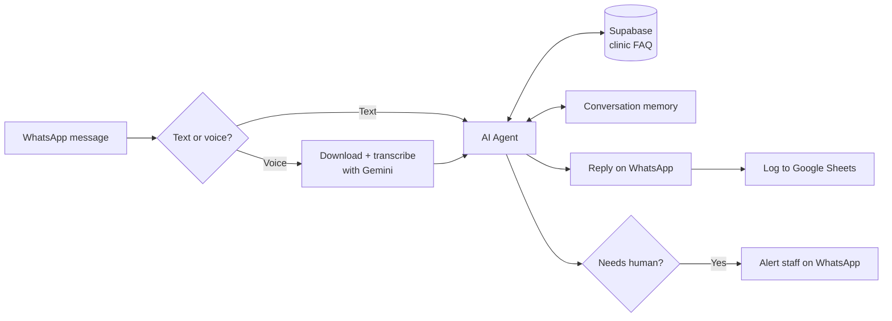

# AI Dental Clinic WhatsApp Assistant

An AI-powered WhatsApp assistant for a dental clinic, built with **n8n**. It answers patient questions 24/7 using the clinic's own FAQ, understands voice notes, remembers the conversation, logs every chat to Google Sheets, and alerts staff on WhatsApp when a human is needed.

## Features

- **WhatsApp chat support** through the WhatsApp Business Cloud API
- **Text and voice messages**: voice notes are downloaded and transcribed with Google Gemini
- **RAG knowledge base**: answers come only from the clinic FAQ stored in a Supabase vector store, so the bot doesn't make up prices or details
- **Conversation memory**: remembers the last 10 messages per customer
- **Human handoff**: bookings, cancellations, emergencies, or unknown questions trigger a WhatsApp alert to staff with a direct chat link
- **Conversation logging**: every message and reply is saved to Google Sheets, with a "Needs Human" flag
- **Multilingual**: replies in the customer's language

## How it works

The project has two workflows:

| Workflow | Purpose |
|---|---|
| `workflows/faq-knowledge-base-loader.json` | Run once. Splits the clinic FAQ into chunks, creates Gemini embeddings, and stores them in Supabase. |
| `workflows/whatsapp-assistant.json` | The live chatbot. Receives WhatsApp messages and replies using the knowledge base. |

## Tech stack

n8n · Google Gemini (chat, embeddings, transcription) · Supabase (pgvector) · WhatsApp Business Cloud API · Google Sheets

## Setup

1. **Supabase**: create a project and a `documents` table with pgvector, following the [n8n Supabase vector store guide](https://docs.n8n.io/integrations/builtin/cluster-nodes/root-nodes/n8n-nodes-langchain.vectorstoresupabase/).
2. **Import** both workflow files into n8n (**Workflows → Import from File**).
3. **Add credentials** in n8n: Google Gemini API, Supabase, WhatsApp (API + Trigger), Google Sheets.
4. **Load the FAQ**: edit the `Clinic FAQ text` node with your clinic's details, then run the loader workflow once.
5. **Configure the assistant**:
   - `Send message` / `Alert staff`: set your WhatsApp Phone Number ID
   - `Alert staff`: set the staff WhatsApp number that receives handoff alerts
   - `Log conversation`: set your Google Sheet ID (columns: `Timestamp, Phone, Message Type, Customer Message, Bot Reply, Needs Human`)
6. **Activate** the assistant workflow and send it a WhatsApp message to test.

